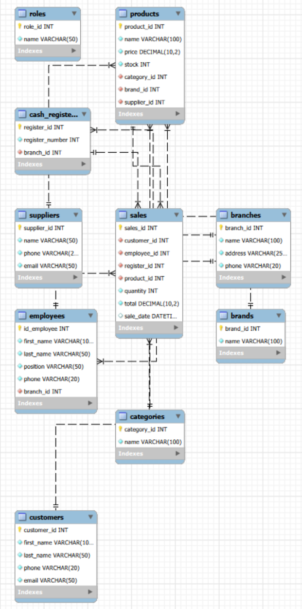

# Proyecto_BD

### Introducción
Este proyecto es el trabajo final de la materia de Base de Datos Avanzada. 
Consiste en el diseño e implementación de una base de datos para **GroceryStore**, una cadena de tiendas de abarrotes con tres sucursales en Tijuana, BC.

La base de datos permite administrar sucursales, empleados, cajas registradoras, productos, clientes y ventas. Además incluye:

- **Procedimientos almacenados** para consultar, insertarm actualizar y eliminar registros.
- **Auditoría automática** mediante triggers que registran cada cambio en una bitácora.
- **Control de acceso por roles** (administración, usuario y analista)
- **Vistas** que generan reportes de ventas.

## Objetivos
- Diseñar un modelo de datos que represente la operación de una tienda de abarrotes con varias sucursales.
- Implementar la base de datos en MySQL con sus tablas, relaciones y datos de prueba.
- Automatizar las operaciones comunes con procedimientos almacenados.
- Registrar los cambios en las tablas con triggers de auditoría.
- Controlar los permisos de acceso con roles y usuarios.
- Generar reportes por medio de vistas.

## Tecnologías
- MySQL Workbench
- Python
- Github

## Diagrama ER

## Modelo de datos
La base de datos se llama **GroceryStore** y tiene 10 tablas
- `branches`
- `employees`
- `cash_registers`
- `categories`
- `brands`
- `suppliers`
- `products`
- `customers`
- `sales`
- `roles`
- `logs`

### Datos
El script incluye datos de ejemplo: 3 sucursales, 6 empleados, 6 cajas, 7 categorías, 10 marcas, 10 proveedores, 15 productos, 8 clientes y 20 ventas distribuidas entre septiembre y noviembre de 2026.

## Procedimientos almacenados
Cada tabla principal tiene un conjunto de procedimientos para operar sobre ella. El nombre sigue el patrón `sp_<Acción><Entidad>`.
| Acción | Ejemplo | Qué hace |
|---|---|---|
| Consultar todos | `sp_GetBranches()` | Devuelve todos los registros |
| Consultar por id | `sp_GetBranchById(1)` | Devuelve un registro |
| Insertar | `sp_InsertBranch(nombre, dirección, teléfono)` | Agrega un registro |
| Actualizar | `sp_UpdateBranch(id, nombre, dirección, teléfono)` | Modifica un registro |
| Eliminar | `sp_DeleteBranch(1)` | Borra un registro |
| Eliminar todos | `sp_DeleteAllBranches()` | Borra todos los registros de la tabla |

Hay procedimientos para `branches`, `employees`, `cash_registers`, `categories`, `brands`, `suppliers`, `products`, `customers` y `sales`

## Auditoría con triggers
 
Cada tabla tiene **3 triggers** (`AFTER INSERT`, `AFTER UPDATE` y `AFTER DELETE`), lo que da un total de **27 triggers**. 
Cada vez que alguien modifica una tabla, el trigger guarda un registro en `logs`.
 
| Columna | Contenido |
|---|---|
| `log_id` | Identificador del registro |
| `entity` | Tabla afectada (por ejemplo `brands`) |
| `dates` | Fecha y hora del cambio (se llena automáticamente) |
| `actions` | `INSERT`, `UPDATE` o `DELETE` |
| `role_name` | Usuario de MySQL que hizo el cambio (`USER()`) |
 
Los triggers se llaman `Log_<acción>_<tabla>`, por ejemplo `Log_insert_brands`.
